# 🏭 Dual‑Stage Smart Conveyor System (ESP32 + FreeRTOS)

[](https://www.espressif.com/)
[](https://github.com/espressif/arduino-esp32)
[]()
[]()

A real‑time multi‑stage conveyor simulation with **product length measurement**, **barcode scanning**, **weight classification**, and **automated gate control**. Designed for the **ESP32** and fully compatible with **Arduino Core 3.0.0+**. The system uses FreeRTOS to run parallel control loops on both cores, ensuring deterministic timing and reliable product tracking.

---

## 📖 Overview

This project simulates a **two‑stage intelligent conveyor belt** capable of:

- Measuring product length using an **obstruction sensor** and high‑precision edge timing.
- Reading **barcodes** and **weight** via simulated sensors.
- Deciding whether to **accept or reject** each product based on predefined length and weight ranges.
- Actuating **gates** with precise timing to route products appropriately.
- Providing real‑time status reports over serial and a **command interface** for on‑the‑fly statistics and emergency control.

All product events are generated by a software simulator that runs alongside your control code, making it perfect for **testing and developing** industrial automation logic without physical hardware.

---

## ✨ Key Features

- **⚡ Real‑time Performance** – FreeRTOS tasks pinned to ESP32’s dual cores for maximum throughput.
- **📏 Length Measurement** – Derived from the time an obstruction sensor is blocked, using a hardware interrupt.
- **📦 Barcode & Weight Integration** – Simulated sensors that activate within defined windows; debounce logic prevents multiple reads.
- **🚦 Intelligent Gate Control** – Gates open/close at exact product positions, accounting for actuator response time.
- **📊 Statistical Monitoring** – Average lengths/weights are computed separately for accepted, rejected, and overall products.
- **🛑 Emergency Stop** – Hardware or software triggered stop that closes all gates and halts processing.
- **🖥️ Real‑time Serial Report** – Periodic output of accept/reject counts and product details; configurable interval.
- **💬 Interactive Commands** – `stat`, `reset`, `emergency` commands for dynamic control.
- **🔄 Collision Detection** – Built‑in safety check on Conveyor 2 that triggers an emergency stop if products collide.
- **🧵 Core‑pinned Tasks** – Conveyor‑1 + reporting on Core 0, Conveyor‑2 on Core 1 for parallel execution.

---

## 📊 System Diagrams

### High‑Level System Flow

```mermaid
flowchart LR
    %% ISR
    subgraph ISR["Interrupt Service Routine"]
        direction TB
        ISR_Title["obstructionSensorISR"]
        ISR_Detect["Detect Rising/Falling Edge"]
        ISR_Capture["Capture Timestamp"]
        ISR_Set["Set newLengthMeasurementAvailable"]
        ISR_Title --> ISR_Detect --> ISR_Capture --> ISR_Set
    end

    %% Core 0 Tasks
    subgraph Core0_Tasks["Core 0 Tasks"]
        direction TB
        subgraph C1["Conveyor 1 Control Task"]
            C1_ProcLen["Process Length Measurement"]
            C1_ProcBarcode["Process Barcode"]
            C1_Gate1["Make Gate 1 Decision"]
            C1_ActGate1["Actuate Gate 1"]
            C1_Transfer["Transfer to Conveyor 2"]
            C1_ProcLen --> C1_ProcBarcode --> C1_Gate1 --> C1_ActGate1 --> C1_Transfer
        end
        subgraph Status["Status Reporting Task"]
            Stat_GenReport["Generate Status Reports"]
            Stat_CalcStats["Calculate Statistics"]
            Stat_Output["Output convRT and convSTAT data"]
            Stat_GenReport --> Stat_CalcStats --> Stat_Output
        end
        subgraph User["User Command Task"]
            User_Process["Process User Commands"]
            User_Handle["Handle 'stat', 'reset', 'emergency'"]
            User_Process --> User_Handle
        end
    end

    %% Core 1 Task
    subgraph Core1_Task["Core 1 Task"]
        direction TB
        subgraph C2["Conveyor 2 Control Task"]
            C2_Receive["Receive Product from Queue"]
            C2_Weight["Process Weight Measurement"]
            C2_Gate2["Make Gate 2 Decision"]
            C2_ActGate2["Actuate Gate 2"]
            C2_Finalize["Finalize Product Status"]
            C2_Receive --> C2_Weight --> C2_Gate2 --> C2_ActGate2 --> C2_Finalize
        end
    end

    %% Inter-Task Communication
    subgraph Comm["Inter-Task Communication"]
        direction TB
        Queue["conv1ToConv2Queue"]
        Mutex1["conv1Mutex, conv2Mutex"]
        Mutex2["reportMutex, statsMutex"]
        SerialMutex["serialMutex"]
        Queue
        Mutex1
        Mutex2
        SerialMutex
    end

    %% Serial Monitor
    SerialMon["Serial Monitor"]

    %% Connection: ISR → Conv1 (new length measurement)
    ISR_Set -->|"newLengthMeasurementAvailable"| C1_ProcLen

    %% Conv1 → Queue → Conv2
    C1_Transfer -->|"xQueueSend"| Queue
    Queue -->|"xQueueReceive"| C2_Receive

    %% Conv2 → Status (stats update)
    C2_Finalize -.->|"update statistics"| Stat_CalcStats

    %% Status → Serial Monitor
    Stat_Output --> SerialMon

    %% User commands interact with system
    User_Handle <--> Comm

    %% Mutex usage (dashed)
    C1_Gate1 -.-> Mutex1
    C2_Finalize -.-> Mutex2
    Stat_Output -.-> SerialMutex
    SerialMon -.-> SerialMutex
```


*Smart Conveyor System – Dual-Stage Smart Conveyor Control System – Architecture overview showing tasks, ISR, inter‑task communication resources, and the serial monitor.*

### Smart Conveyor System – Data Flow
```mermaid
graph TB
    %% Styles
    classDef green fill:#e8f5e9,stroke:#2e7d32,stroke-width:2px
    classDef blue fill:#e3f2fd,stroke:#1565c0,stroke-width:2px
    classDef orange fill:#fff3e0,stroke:#bf360c,stroke-width:2px
    classDef gray fill:#f5f5f5,stroke:#666,stroke-width:2px
    classDef whiteBox fill:#fff,stroke:#333,stroke-width:1px

    %% Data Collection Points
    subgraph DC["Data Collection Points"]
      sensors["<b>Sensor Triggers</b><br/>• Obstruction Sensor (Length)<br/>• Barcode Sensor (Product ID)<br/>• Weight Sensor (Weight)"]
    end

    %% TrackedProduct
    subgraph TP["TrackedProduct"]
      product["<b>Product Data Fields</b><br/>"
              "ID: barcodeID, tempID<br/>"
              "Measurements: length, weight<br/>"
              "Status: NONE → PROCESSED<br/>"
              "Quality Flags: isLengthOK, isWeightOK<br/>"
              "Timing: entryTimeConv1, entryTimeConv2<br/>"
              "Gate Control: gate1DecisionMade, gate2DecisionMade<br/>"
              "Reporting: forRealTimeReport"]
    end

    %% Real-Time Reporting
    subgraph RT["Real-Time Reporting (1-sec interval)"]
      direction LR
      rt_flow["<b>Data Collection Flow</b><br/>1. Status changes<br/>2. addProductToReport()<br/>3. Product added to productsForReport[]<br/>4. formatReportString() builds statusBuffer"]
      rt_output["<b>Real-Time Output Format</b><br/>• Product IDs<br/>• Length measurements (cm)<br/>• Weight measurements (g)<br/>• Accept/Reject counters"]
      rt_flow --> rt_output
    end

    %% Statistical Reporting
    subgraph STAT["Statistical Reporting (on-demand via 'stat' command)"]
      direction LR
      stat_accum["<b>Statistical Accumulators</b><br/><b>Length Statistics</b><br/><b>Weight Statistics</b>"]
      stat_output["<b>Statistical Output Format</b><br/>• Average Total Length<br/>• Average Acceptable Length<br/>• Average Defective Length<br/>• Average Total Weight<br/>• Average Acceptable Weight<br/>• Average Defective Weight"]
      stat_accum --> stat_output
    end

    %% Sample Outputs
    subgraph SAMPLES["Sample Output Examples"]
      rt_sample["<b>Real-time</b><br/>convRT:019,011,1001,5.0,100.0,1002,4.9,98.0,1003,5.1,102.0<br/><i>(19 accepted, 11 rejected, product details)</i>"]
      stat_sample["<b>Statistical</b><br/>convSTAT:4.98,5.01,4.83,99.8,100.2,98.6<br/><i>(Average lengths and weights)</i>"]
    end

    %% Connections
    DC -->|<b>Product data captured</b>| TP
    TP -->|<b>Update Real-Time Report<br/>when status changes</b>| RT
    TP -->|<b>Update Statistical Accumulators<br/>when measurements taken</b>| STAT
    rt_output --> rt_sample
    stat_output --> stat_sample

    %% Apply styles
    class DC,rt_flow,rt_output green
    class TP,product blue
    class STAT,stat_accum,stat_output orange
    class SAMPLES,rt_sample,stat_sample gray
```

*FreeRTOS mutexes and the inter‑core queue protect all shared product data and statistics across Core 0 and Core 1.*

### Product State Machine

```mermaid
flowchart LR

    %% ── Start & initial state ──
    start(( ))
    s1["PRODUCT_STATUS_NONE<br/>(Initial State)"]

    start --> s1

    %% ── Conveyor 1 States ──
    subgraph Conv1["Conveyor 1 States"]
        s2["PRODUCT_STATUS_ON_CONV1<br/>(Product Enters Conveyor 1)"]
        s3["PRODUCT_STATUS_LENGTH_MEASURED<br/>(Obstruction Sensor)"]
        s4["PRODUCT_STATUS_BARCODED<br/>(Barcode Sensor)"]
        s5["PRODUCT_STATUS_AWAITING_GATE1_DECISION"]
        d1{"Gate 1 Decision"}
        s6["PRODUCT_STATUS_REJECTED_AT_GATE1"]
    end

    s1 --> s2
    s2 -- "Obstruction sensor rise & fall" --> s3
    s3 -- "Barcode reader detects product" --> s4
    s4 -- "Product approaches Gate 1" --> s5
    s5 --> d1
    d1 -- "Length not in range<br/>(4.8-5.2 cm)" --> s6
    d1 -- "Length in range<br/>(4.8-5.2 cm)" --> s7

    %% ── Transfer point ──
    s7["PRODUCT_STATUS_TRANSFERRED_TO_CONV2"]

    %% ── Conveyor 2 States ──
    subgraph Conv2["Conveyor 2 States"]
        s8["PRODUCT_STATUS_ON_CONV2"]
        s9["PRODUCT_STATUS_WEIGHT_MEASURED<br/>(Weight Sensor)"]
        s10["PRODUCT_STATUS_AWAITING_GATE2_DECISION"]
        d2{"Gate 2 Decision"}
        s11["PRODUCT_STATUS_REJECTED_AT_GATE2"]
        s12["PRODUCT_STATUS_ACCEPTED_FINAL"]
    end

    s7 -- "Transfer point" --> s8
    s8 -- "Weight sensor detects product" --> s9
    s9 -- "Product approaches Gate 2" --> s10
    s10 --> d2
    d2 -- "Weight not in range<br/>(95-105 g)" --> s11
    d2 -- "Weight in range<br/>(95-105 g)" --> s12

    %% ── Finalised & end ──
    s13["PRODUCT_STATUS_PROCESSED<br/>(Removed from Tracking)"]
    endNode(( ))

    s6 -- "Product removed<br/>from tracking" --> s13
    s11 -- "Product removed<br/>from tracking" --> s13
    s12 -- "Product removed<br/>from tracking" --> s13
    s13 --> endNode
```


*Product lifecycle from entry through length measurement, barcoding, weight check, and final accept/reject.*

---

## 🎛️ Hardware & Pinout

| **Function**               | **GPIO** | **Direction** | **Description**                              |
|----------------------------|----------|---------------|----------------------------------------------|
| Obstruction Sensor Output  | 32       | OUTPUT        | Simulated sensor signal (HIGH = blocked)     |
| Gate 1 Control             | 33       | OUTPUT        | Physical gate signal (monitor with scope)    |
| Gate 2 Control             | 15       | OUTPUT        | Physical gate signal (monitor with scope)    |
| Debug LEDs (optional)      | 12,13,14 | OUTPUT        | Toggle per product scheduler for visual debug|

> **Note:** The obstruction sensor pin (32) is also read as an **input** inside the control task to enable a hardware interrupt on both rising and falling edges.

---

## 🧰 Software Requirements

- **ESP32 Arduino Core** – version **3.0.0 or later** (tested with 3.1.1).
- **Arduino IDE** (or PlatformIO / any compatible environment).
- No external libraries – only built‑in FreeRTOS and ESP32 components.

> ⚠️ **Important:** This project was **recently migrated** to the new `esp_timer` API because the old `hw_timer_t` (hardware timer) was removed in Core 3.0.0+. All timer‑based scheduling now uses `esp_timer_create()` and `esp_timer_start_once()`.

---

## 🚀 Installation & Setup

1. **Install ESP32 Arduino Core 3.0.0+**  
   In Arduino IDE: *File → Preferences → Additional Boards Manager URLs*  
   Add: `https://espressif.github.io/arduino-esp32/package_esp32_index.json`  
   Then install “ESP32 by Espressif Systems” from the Boards Manager.

2. **Clone this repository** (or copy the code into a new sketch).

3. **Select your board**  
   *Tools → Board → ESP32 → ESP32 Dev Module* (or your specific ESP32 variant).

4. **Configure flash size & upload speed** as needed (defaults work fine).

5. **Compile & Upload** the sketch to your ESP32.

6. **Open Serial Monitor** at `115200` baud.  
   You should see:  

```bash
System Initializing...
Dual-Stage Smart Conveyor System Initialized and Running.
```

---

## 🎮 Usage

Once running, the simulator automatically starts feeding products from the `productArray` (30 products in the default configuration). You can monitor and control the system over the serial port.

### 📊 Real‑time Status Report (every 1 second)

```bash
convRT:005,002,1001,5.0,100.0,1002,4.9,98.0,1003,5.1,102.0,...
```


**Format:**  
`convRT:<AcceptCount>,<RejectCount>[,<Barcode>,<Length>,<Weight>,...]`  
- Accept/Reject counts are 3‑digit zero‑padded.  
- For each recently processed product, its barcode, length (1 decimal), and weight (1 decimal) are listed.  
- Products rejected at Gate 1 show `weight = 0.0`.  
- The report list is cleared after each transmission.

### 💬 Serial Commands

| **Command**  | **Description**                                                                 |
|--------------|---------------------------------------------------------------------------------|
| `stat`       | Print statistical averages (overall, acceptable, defective lengths & weights).  |
| `reset`      | Reset all counters, statistics, and product buffers. Gates are closed.           |
| `emergency`  | Trigger an immediate emergency stop (closes gates, halts processing).            |
| *(anything else)* | Prints `"Unknown command."`                                                  |

**Example output of `stat`:**  

```bash
convSTAT:4.97,5.00,4.20,99.5,100.0,94.0
```
Means:  
- Average total length: 4.97 cm  
- Average acceptable length: 5.00 cm  
- Average defective length: 4.20 cm  
- Average total weight: 99.5 g  
- Average acceptable weight: 100.0 g  
- Average defective weight: 94.0 g

---

## 🧠 System Architecture

### Task Layout (Dual‑Core)

| **Task**               | **Core** | **Priority** | **Responsibilities**                                                   |
|------------------------|----------|--------------|-------------------------------------------------------------------------|
| `ProductLoader`       | Any¹     | Highest      | Loads new products from the array every 450 ms into available schedulers. |
| `Conv1Ctrl`           | Core 0   | High         | Length measurement, barcode reading, Gate 1 decision & actuation, product transfer to Conveyor 2. |
| `StatusReport`        | Core 0   | Medium       | Periodically prints the `convRT` line with product data.                |
| `UserCmd`             | Core 0   | Low          | Listens for serial commands (`stat`, `reset`, `emergency`).            |
| `Conv2Ctrl`           | Core 1   | High         | Receives products from queue, weight reading, Gate 2 decision & actuation, final product disposition, collision detection. |

¹ The `ProductLoader` is not pinned and will run on whichever core is available, but it only inserts simulation events and does not interfere with the main control loops.

### Conveyor Workflow

1. **Conveyor 1** (speed 100 cm/s)  
   - Obstruction sensor detects product entry → length calculated.  
   - Barcode sensor activated when product reaches the reading window.  
   - Gate 1 opens if length is within `[4.8, 5.2] cm`.  
   - Acceptable products are transferred to Conveyor 2; rejects are counted.

2. **Conveyor 2** (speed 80 cm/s)  
   - Weight sensor becomes active as the product passes over it.  
   - Gate 2 opens only if **both** length and weight are OK (`[95.0, 105.0] g`).  
   - Products that fail at either stage are rejected; successful ones are accepted.  
   - A collision safety system monitors the distance between consecutive products.

### Simulator Design

The simulator itself uses **product schedulers** (up to 4 in parallel) that each own an `esp_timer`. Each scheduler holds a timeline of absolute‑time events for a single product. When a timer fires, the appropriate sensor value (obstruction, barcode, weight) is updated on the global variables, exactly as if a physical object was moving down the conveyor.

---

## 🐛 Debugging

- Uncomment `//*Debug*//` messages to enable detailed per‑product logs on the serial port.
- Watch the `DEBUG_PIN` (GPIO 12) and the two following pins (GPIO 13, 14) with an oscilloscope/logic analyser – they toggle every time a product event fires (one for each active scheduler).
- Check the **obstruction sensor pin** (GPIO 32) – it outputs the simulated pulse that you can also use to trigger an external scope.

---

## 🔄 Compatibility & Migration to Arduino Core 3.0.0+

In earlier versions of the ESP32 Arduino Core, hardware timers (`hw_timer_t` and associated functions) were available. These were **deprecated and removed in Core 3.0.0+**. The current codebase has been fully migrated to the **`esp_timer` API**:

- `hw_timer_t` → `esp_timer_handle_t`  
- `timerBegin()`, `timerAttachInterruptArg()`, `timerAlarm()` → `esp_timer_create()`, `esp_timer_start_once()`  
- Timer ISRs now run in the `ESP_TIMER_TASK` context (not as true interrupt service routines), which is safer and thread‑aware.

No other functional changes were made. The behaviour of the system remains identical.

---

## 📜 License

This project is released under the **MIT License**. See `LICENSE` file for details.

---

## 🤝 Contributions

Pull requests are welcome. If you find a bug or want to add features, feel free to open an issue.

---

*Built for education, research, and industrial control prototyping. Happy automating!*